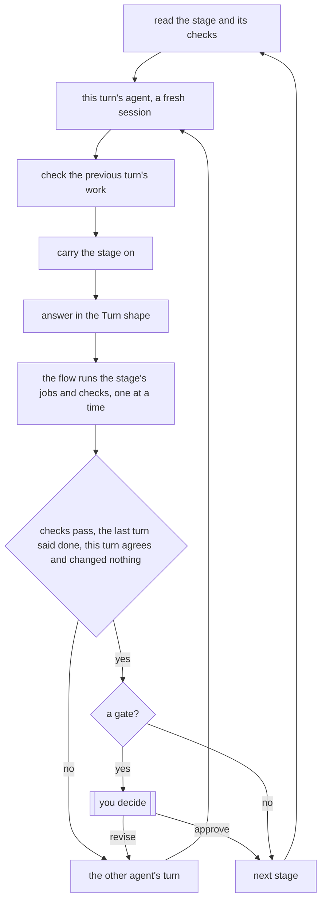

# wordbeat _(wordbeat-flow)_

A humanize (hmz) flow for word-synced videos: every visual hit lands on a keyword of the
voice-over, measured frame by frame before delivery.

A beat-synced video lands its cuts on the drum; a wordbeat video lands its motions on the
narration's keywords. The voice comes first: every character is timed, and the picture looks up
each motion's frame from that table. Two coding agents take turns on every stage, each checking
the other's work in a fresh session, while the flow runs the heavy jobs and the measurements
itself. You decide at four gates: the script, the voice, a sample, and the finished film.

## Table of Contents

- [Background](#background)
- [Install](#install)
- [Usage](#usage)
  - [Roles](#roles)
  - [Stages and gates](#stages-and-gates)
  - [Taking part](#taking-part)
  - [Params](#params)
  - [What it writes](#what-it-writes)
  - [What it reaches over the network](#what-it-reaches-over-the-network)
- [Maintainers](#maintainers)
- [Contributing](#contributing)
- [License](#license)

## Background



wordbeat is adapted from [kazi](https://github.com/syydaniel/kazi) by syydaniel.

## Install

You need [hmz](https://github.com/humanfia/humanize). Once the flow is listed in the official
flowverse, open `/flow` in hmz, go to **Flowverses → official → zevorn/wordbeat** and
**Install** it. To run a tagged release without installing it, or a checkout by its path:

```sh
hmz exec -f 'git+https://github.com/zevorn/wordbeat-flow@v0.1.0#wordbeat' ...
hmz exec -f ./wordbeat-flow/wordbeat ...
```

### Requirements

The flow depends on no platform: the speech models run on MLX on Apple silicon and on PyTorch
(CUDA, Apple's MPS or the CPU) everywhere else, Remotion's renderer is a param, and every other
tool is cross-platform. The machine needs:

- **ffmpeg** and **ffprobe**. On macOS the mix uses Apple's `aac_at` encoder when ffmpeg has it,
  and ffmpeg's own `aac` elsewhere.
- **Node.js 20 or newer** with npm, for [Remotion](https://www.remotion.dev). The flow copies the
  starter project into `film/` and runs `npm ci` there once.
- **A Python 3.12** with the toolkit's packages, named by the `python` param:

  ```sh
  cd wordbeat/toolkit   # inside the installed flow
  # Apple silicon, with MLX:
  uv pip install --python /path/to/python -r requirements.txt -r requirements-mlx.txt
  # anywhere else, with PyTorch on CUDA, MPS or the CPU:
  uv pip install --python /path/to/python -r requirements.txt -r requirements-torch.txt \
      --override overrides-torch.txt
  ```

  The models download on first use, a few GB in all: Qwen3-TTS 1.7B Base,
  Qwen3-ForcedAligner 0.6B, Whisper large-v3-turbo.
- **A reference recording** of the voice to clone, about ten clean seconds, with its transcript
  in a `.txt` file of the same name beside it; or a finished narration recording.
- **For music=ace**, a running [ACE-Step 1.5](https://github.com/ace-step/ACE-Step-1.5) REST API
  (`acestep-api`, port 8001 by default).
- **For master=hdr**, zsh, `dovi_tool` and `MP4Box` (GPAC), and an ffmpeg with libx265.

The run checks all of this before the first turn and names whatever is missing.

The agents' CLIs must be able to ask their user mid-turn: Claude Code, Codex, Kimi Code, pi or
Oh My Pi. Any other is refused before the first turn.

## Usage

```sh
hmz exec -f zevorn/wordbeat \
    -a first_chaser=claude/claude-opus-5-5:high \
    -a second_chaser=codex/gpt-5.6-sol:high \
    -p budget.cost=40,budget.duration=6h \
    -p project=films/planets,voice_ref=voice/ref.wav,minutes=2 \
    -p python=/path/to/toolkit/python,gates=auto \
    "Explain the eight planets of the solar system to curious teenagers, in Chinese."
```

At the hmz prompt, `$zevorn/wordbeat Explain the eight planets ...` asks for the params in a form
and asks you at each gate. `hmz exec` has nobody at a prompt, so run it with `gates=auto`, or
with `gates=ask` to have it stop at the first gate; pick the run up with `/resume` to answer.

Each stage can run alone: `zevorn/wordbeat:script`, `:voice`, `:film` (the sample and the film),
`:music` and `:finish`.

### Roles

| Role | What it is for |
| --- | --- |
| `first_chaser` | One of the two agents taking turns on every stage: writes, builds, checks the other's work |
| `second_chaser` | The other; give it another CLI or model, so each catches what the other misses |
| `human` | You, at the gates and when an agent asks; filled by hmz, never with `-a` |

Both agents run with `local=ALL`, `user=ALL`, `system=READ`, `online=ALL`: npm and npx keep their
caches in your home directory, and the agents look up libraries and styles on the web. Both carry
the `wordbeat` skill.

### Stages and gates

| Stage | The agents | The flow runs, after every turn that changed a file | Gate |
| --- | --- | --- | --- |
| script | write `script.txt` | `lint_script.py` | you read the script |
| voice | fix readings in `script.txt` | `voice.py`, `tempo.py`, `pace.py`, `timeline.py`, `polyphone.py` | you hear the narration |
| sample | build the opening in `film/` | `tsc`, `npm run layout`, a half-size render, `kazi_check.py`, contact sheets | you watch the sample at full size |
| film | build the rest | the same over the whole film, and its length | |
| music | write `audio/music_brief.json` | `ace_music.py`, `music_check.py` | |
| finish | fix what the checks find, write `out/publish.md` | cues, the full render, `mix.py`, `kazi_check.py`, `caption_check.py`, the cover | you watch the film |

A stage ends when its checks pass, one agent says it is done, and the other, in the next turn,
agrees without changing a file. Heavy jobs run one at a time, and only when their inputs changed.
After `max_turns` turns without agreement the stage goes to you.

### Taking part

- **At a gate** the question carries what you judge: the script with line numbers, every line's
  read-back, the measurements. The audio, the video and the contact sheets open in your default
  player first (`preview_open`). Answer `approve`, `revise` or `back`, with notes.
- **revise** sends your notes into the session of the agent that last changed the stage's work,
  carried on from where it stood, so it remembers why it did what it did; the other agent then
  checks the change in a fresh session.
- **back** returns to the previous stage with your notes.
- **keep** makes your notes a standing rule: every later session starts with them.
- **An agent's question** mid-turn comes to you in hmz, and your answer goes back into that turn.
- **Steering**: whatever you type while an agent works goes into its turn, as anywhere in hmz.

### Params

| Param | Default | What it does |
| --- | --- | --- |
| `project` | `.` | the project directory, relative to where the run starts |
| `lang` | `zh` | `zh` or `en`: narration and captions |
| `minutes` | `2` | the target length |
| `orientation` | `landscape` | 1920x1080, or 1080x1920 for `portrait` |
| `voice_ref` | | the voice to clone (its transcript beside it as `.txt`) |
| `narration` | | a finished recording to time instead |
| `takes` | `4` | takes per line; the best is kept |
| `tempo` | `1.0` | speed the narration without changing pitch |
| `master` | `none` | `4k`, or `hdr` for 4K plus Dolby Vision 8.4 and HLG, after the final gate |
| `python` | `python3` | the Python with the toolkit's packages |
| `speech_backend` | `auto` | `mlx` or `torch`; `auto` takes MLX where it is installed |
| `gl` | `angle` | Remotion's OpenGL renderer; `swangle` without a GPU |
| `hf_home` | | `HF_HOME` for the models |
| `concurrency` | `4` | Remotion's render concurrency |
| `heavy_timeout` | `0` | seconds one heavy job may take; `0` for no limit |
| `sample_seconds` | `25` | the sample's length |
| `min_kazi_rate` | `0.9` | the share of keywords the picture must hit |
| `max_turns` | `12` | turns per stage before you decide |
| `music` | `ace` | `ace`, `file` (`music_file`) or `none` |
| `music_file` | | the music bed to use when `music=file` |
| `ace_url` | `http://127.0.0.1:8001` | the ACE-Step API |
| `ace_steps` | `8` | ACE-Step inference steps |
| `ace_model` | | an ACE-Step DiT model; empty for the server's |
| `gates` | `ask` | `auto` lets the agents decide every gate |
| `preview_open` | `true` | open the media before a gate asks |

### What it writes

Everything goes in the project directory: `script.txt`, `vo/`, `vo_paced/`, `timeline.json`,
`film/` (a Remotion project), `audio/`, `out/` (`sample.mp4`, `final.mp4`, `cover.png`,
`publish.md`, and `final_4k.mp4` or `hdr/` when mastered) and `.wordbeat/` (check reports and
contact sheets). It writes nothing outside it, makes no commits and pushes nothing. The agents
may install npm packages into `film/`.

### What it reaches over the network

- Hugging Face, and OpenAI's model host for Whisper on PyTorch, once each, to download the models.
- The npm registry, for `npm ci` in `film/` and any package the agents add.
- The ACE-Step API at `ace_url`, normally on the same machine.
- Whatever the agents look up on the web.

## Maintainers

[@zevorn](https://github.com/zevorn)

## Contributing

Issues and pull requests are welcome. Run what CI runs before you open one:

```sh
uv sync --locked
uv run ruff check
uv run pytest
```

## License

[Apache-2.0](LICENSE) © zevorn. The code adapted from
[kazi](https://github.com/syydaniel/kazi) keeps its [MIT License](wordbeat/toolkit/LICENSE-kazi)
© 2026 Yiyang.
